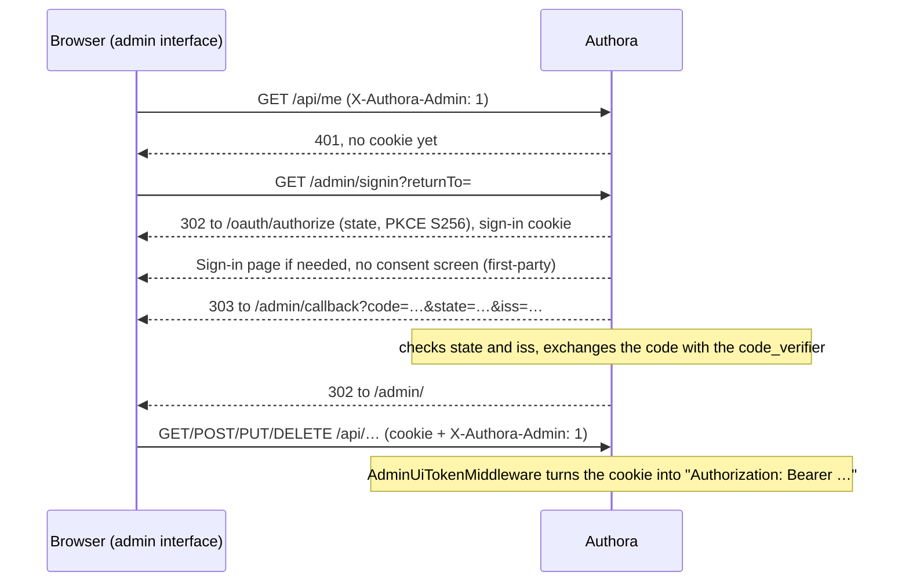

# Authora – Administration

This document describes the admin interface (US-033) and the audit log (US-034). The admin API itself is documented in Swagger (`/swagger` in Development); its authorization is described in [oauth-core.md](oauth-core.md) and `CLAUDE.md`.

- Admin interface: `src/Authora.Api/wwwroot/admin/` (static files), `src/Authora.Api/Controllers/AdminUiController.cs` and `src/Authora.Api/AdminUi/` (backend for frontend), `MeController.cs`
- Audit log: `src/Authora.Core/Application/Audit/`, `src/Authora.Infrastructure/Persistence/AuditLog.cs`, `src/Authora.Infrastructure/Auditing/` (hash chain), `src/Authora.Api/Controllers/AuditEventsController.cs`

## Admin interface (US-033)

The admin interface is served at `{Issuer}/admin/`. It manages Users, Groups, Roles, Clients and Scopes and shows the audit log, so Authora can be operated without database access.

### How it works

The admin interface is a browser app made of static files (HTML, CSS and JavaScript modules, no build step) with a small backend for frontend in Authora (TD-014, `AdminUiController`). The backend runs the Authorization Code flow for the admin interface's Client on the server and keeps the tokens in an encrypted `HttpOnly` cookie, so no script in the browser ever sees a token. The admin API itself is unchanged: it gets the Access Token from the cookie as a Bearer token and checks it like that of any other Client.

- **Client:** at startup, Authora creates the first-party Public Client `Authora Admin UI` with the Redirect URI `{Issuer}/admin/callback` and the allowed Scope `authora.admin`, unless a Client with this Redirect URI already exists. The backend uses the oldest enabled Public Client with this Redirect URI. Disabling that Client disables the admin interface; deleting it recreates it on the next start. With an Issuer like `http://localhost:5000`, the Client cannot be created (HTTP Redirect URIs need a loopback IP address), and event 7009 is logged. A Client created by an older version with the Redirect URI `{Issuer}/admin/` is no longer used and can be deleted.
- **Consent:** the Client is first-party (TD-012), so administrators are not asked for consent on every sign-in; a signed-in administrator comes right back from `/oauth/authorize`. See [oauth-core.md](oauth-core.md#consent-policy).
- **Permissions:** the Access Token only says that the User signed in to the admin interface. Every action still needs the User's Permission, checked by the admin API. `GET /api/me` returns the User and their Permissions, and the interface hides what the User may not do; this is only for convenience, not a security boundary.
- **Tokens:** kept only in the cookie `__Host-authora_admin`, encrypted with ASP.NET Core Data Protection, `HttpOnly`, `Secure`, `SameSite=Strict`, without expiry (it ends when the browser closes). Several tabs share it. On `401`, the interface calls `POST /admin/session/refresh` once, in one tab at a time (Web Locks), because a Refresh Token used twice revokes the whole Grant; the server skips the refresh if another tab did it in the last 10 seconds. If that fails, the interface signs in again.
- **Sign-out:** `POST /admin/session/signout` revokes the Refresh Token (and with it the Grant and its Access Tokens) and deletes the cookie; the interface then opens `/account/logout`, which ends the Session.

| Endpoint | Purpose |
|---|---|
| `GET /admin/signin?returnTo=#/…` | Starts the sign-in: a new `state` and PKCE verifier in the sign-in cookie `__Host-authora_admin_signin` (encrypted, `HttpOnly`, `SameSite=Lax`, 10 minutes), then a redirect to `/oauth/authorize`. `returnTo` must be a view of the admin interface (`#/…`). |
| `GET /admin/callback` | The Redirect URI. Takes the sign-in cookie (single use), checks `state` and `iss`, exchanges the code on the server and sets the cookie with the tokens. Errors are sent to `/admin/?error=…` (`access_denied`, `unavailable`, `invalid_response`, `sign_in_failed`); the interface only shows fixed texts for these codes. Rate limit of the token endpoint. |
| `POST /admin/session/refresh` | Refreshes the tokens in the cookie (`204`), or deletes it (`401`). Needs `X-Authora-Admin: 1`. Rate limit of the token endpoint. |
| `POST /admin/session/signout` | Revokes the Grant and deletes the cookie (`204`). Needs `X-Authora-Admin: 1`. |

These endpoints are for the browser of the admin interface, not for Clients, so they are not in Swagger.

### Security

| Measure | Purpose |
|---|---|
| Tokens only in an encrypted `HttpOnly` cookie (backend for frontend, TD-014) | A script that runs on the admin interface cannot read the tokens and use them elsewhere. |
| `state` and the PKCE `code_verifier` stay on the server; the callback only redeems codes of sign-ins it started | A script that starts its own authorization request cannot redeem the code: it is sent to `/admin/callback`, which rejects a foreign `state` without redeeming the code and redirects without it. |
| The admin API only uses the cookie with the header `X-Authora-Admin: 1`, not for `Sec-Fetch-Site` other than `same-origin`, and the cookie is `SameSite=Strict` | No CSRF: a cross-site request cannot send the header without a CORS preflight, which `/api/*` never allows. The session endpoints need the header too. |
| Content Security Policy `default-src 'none'; script-src 'self'; style-src 'self'; img-src 'self' data:; connect-src 'self'; form-action 'self'; frame-ancestors 'none'; base-uri 'none'` | No inline or foreign scripts or styles can run. No framing (clickjacking). |
| All text is inserted as text nodes, never as HTML; sign-in errors are fixed texts for known codes | Names and descriptions from the API cannot inject markup, and a link cannot put its own text into the admin interface. |
| `Cross-Origin-Opener-Policy: same-origin` | Other windows cannot reach the admin interface through `window.opener`. |
| `iss` is checked on the authorization response | Mix-up attacks (RFC 9207). |
| `Cache-Control: no-cache` for all files, `no-store` for the session endpoints | Browsers load the new version after an update and never cache a response that sets the cookie. |

What remains: a script that runs on the admin interface can still act as the signed-in administrator while the page is open, like on any web application. The Content Security Policy is what keeps such a script out.

### Configuration

| Setting | Default | Description |
|---|---|---|
| `Authora:AdminUi:Enabled` | `true` | When `false`, `/admin/*` answers `404` and the Client is not created. An existing Client is kept. |
| `Authora:DataProtection:KeysPath` | not set | Directory for the Data Protection keys that encrypt the cookies, see [operations.md](operations.md#data-protection-keys). Required for several instances; without it, restarts may sign administrators out. |

### Pages

| Page | Needs | Supported changes |
|---|---|---|
| Users | `users.read` | Create, edit Email and Name, set password, activate, deactivate, unlock, sign out everywhere, delete, assign and remove Roles. Shows Groups and effective Permissions with their source. |
| Groups | `groups.read` | Create, edit, delete, assign and remove Roles (not the administrator Role), add members by searching Users, remove members. |
| Roles | `roles.read` | Create, edit, delete (not System Roles), grant and revoke Permissions (not on the administrator Role). |
| Clients | `clients.read` | Register (the Secret of a Confidential Client is shown once), edit, enable, disable, mark as first-party or third-party (`clients.manage-first-party`), delete, add and remove Redirect URIs, allow Scopes, serve Scopes, create and revoke Secrets. |
| Scopes | `scopes.read` | Create, edit, delete (optionally removing it from Clients). |
| Audit log | `audit.read` | Search, see below. |

Each change needs the Permission of its endpoint, e.g. `users.set-password`. Successful changes and errors (the `detail` of the problem details, or the validation messages) are shown as messages in the corner of the page. Destructive actions ask for confirmation.

## Audit log (US-034)

Security-relevant events are stored in the table `audit.events` (schema `audit`). They are only ever added; neither the API nor the admin interface can change or delete them, and a hash chain detects changes in the database (see [Hash chain](#hash-chain-td-013)). The cleanup deletes them after `Authora:Cleanup:AuditRetention` (default 365 days, at least 30).

### What is recorded

| Area | Types |
|---|---|
| Sign-in | `account.sign-in` (succeeded, or failed with the reason: unknown Email, wrong password, locked out, cannot sign in), `account.locked-out`, `account.signed-out` |
| Attacks on tokens | `oauth.authorization-code-reused`, `oauth.refresh-token-reused` |
| Users | `user.created`, `user.updated`, `user.deleted`, `user.activated`, `user.deactivated`, `user.unlocked`, `user.sessions-revoked`, `user.password-set`, `user.role-assigned`, `user.role-removed` |
| Groups | `group.created`, `group.updated`, `group.deleted`, `group.member-added`, `group.member-removed`, `group.role-assigned`, `group.role-removed` |
| Roles | `role.created`, `role.updated`, `role.deleted`, `role.permission-granted`, `role.permission-revoked` |
| Scopes | `scope.created`, `scope.updated`, `scope.deleted` |
| Clients | `client.registered`, `client.updated`, `client.deleted`, `client.enabled`, `client.disabled`, `client.redirect-uri-added`, `client.redirect-uri-removed`, `client.scope-allowed`, `client.scope-disallowed`, `client.scope-served`, `client.scope-no-longer-served`, `client.secret-created`, `client.secret-revoked`, `client.marked-first-party`, `client.marked-third-party` |
| Authora | `system.administrator-bootstrapped`, `system.client-bootstrapped`, `system.signing-keys-changed` |

Each event has:

| Field | Content |
|---|---|
| `occurredAt` | Time (UTC). |
| `type`, `outcome` | What happened and whether it `Succeeded` or `Failed`. |
| `actorUserId`, `actorClientId` | The User of the Access Token or Session and the Client of the Access Token. For events at the token endpoint, the Client that called it. Empty for events of Authora itself. |
| `ipAddress` | The IP address of the request. Behind a reverse proxy only correct with `Authora:ForwardedHeaders`, see [operations.md](operations.md#reverse-proxy). |
| `targetType`, `targetId` | The object: `user`, `group`, `role`, `scope`, `client` or `signing-key` and its Id (`kid` for keys). |
| `details` | A short description, e.g. the Name of an assigned Role. |

Rules:

- Changes are recorded in the same transaction as the change itself, so an event exists if and only if the change was saved. Requests that change nothing (e.g. assigning a Role that is already assigned) and rejected requests record nothing.
- Failed sign-ins and token reuse are recorded right away, independent of other changes.
- Sign-in events have the User as target, because nobody is signed in yet when they occur. Search by `targetId` to see the sign-ins of a User.
- **Never recorded:** passwords, Session tokens, codes, Access and Refresh Tokens, Client Secrets, private keys. The Email of a failed sign-in for an unknown account is not recorded either, because it may be a password typed into the wrong field. Only Ids and Names are recorded.
- The Email of the acting User and the Name of the acting Client are looked up when reading, so they are current and are not copied into the log.

### Searching

`GET /api/audit-events` needs the Permission `audit.read`, which only the administrator Role has by default. Access is itself restricted to Access Tokens with `authora.admin`, like the whole admin API.

| Parameter | Matches |
|---|---|
| `type` | A Type (`user.created`) or an area (`user` matches `user.*`). |
| `actorUserId` | Events caused by this User. |
| `targetType`, `targetId` | Events about this object. |
| `outcome` | `Succeeded` or `Failed`. |
| `from`, `to` | `from` ≤ time < `to`, ISO 8601 with offset, e.g. `2026-10-01T00:00:00Z`. |
| `page`, `pageSize` | 1-based page, at most 200 events per page. |

The newest events come first. The admin interface links from Users, Groups, Roles, Clients and Scopes to their events.

### Hash chain (TD-013)

Every few seconds (`Authora:Audit:SealInterval`, default `00:00:05`, at most 5 minutes), a background service seals the new events into a hash chain in the table `audit.chain`: each link stores a Sequence without gaps, the Id of the event, the hash of the previous link and SHA-256 over its Sequence, the previous hash and every field of the event. Links are inserted, never updated, so `audit.events` still needs no `UPDATE`. Several instances take turns under an advisory lock. After every batch, the sealing logs a **checkpoint** (event 11001: Sequence and hash of the last link).

`GET /api/audit-events/verification` (Permission `audit.verify`, administrator Role by default) recomputes the chain from its first remaining link and reports `isIntact`, the first and last Sequence, the last hash, and the first problem:

| Problem | Cause |
|---|---|
| Missing links | Links were deleted in the database. |
| A link does not continue the previous hash, or its event hashes differently | A sealed event or link was changed. |
| The event of a link was deleted | A sealed event was deleted. |
| `unsealedEvents` > 0 | Events older than the sealing interval plus a minute are not in the chain, e.g. inserted directly into the database with an old time (the sealing only looks one hour behind its last run, except on its first run). |
| `checkpointMatches: false` | Pass `checkpointSequence` and `checkpointHash` from a logged checkpoint: a different hash means the chain was rebuilt after a change, a Sequence beyond the end means the end of the chain was cut off. |

A broken chain is also logged as critical event 11011. Someone with write access to the database can still rebuild the whole chain after a change; only the checkpoints in a separate log system show that, so ship the application logs elsewhere and compare a recent checkpoint now and then. Until an event is sealed (a few seconds), it can be changed without a trace.

The cleanup deletes events after the retention together with their links, only from the start of the chain, so the rest still verifies; the last link is always kept, so the chain continues. The verification trusts the first remaining link.

| Setting | Default | Description |
|---|---|---|
| `Authora:Audit:SealInterval` | `00:00:05` | How often new events are sealed, between 1 second and 5 minutes. |
| `Authora:Audit:BatchSize` | `1000` | Events sealed or verified per batch, 1 to 10000. |

### Limitations

The events are stored in Authora's own database. The hash chain makes changes detectable, but does not prevent them, and only the checkpoints in the application logs detect a rebuilt chain (see above). For storage that cannot be changed at all, forward the application logs or the events to an append-only system (e.g. a SIEM or object storage with retention locks); they contain the security events (sign-ins, lockouts, token reuse, key changes), most changes with their Event Ids, and the checkpoints.
