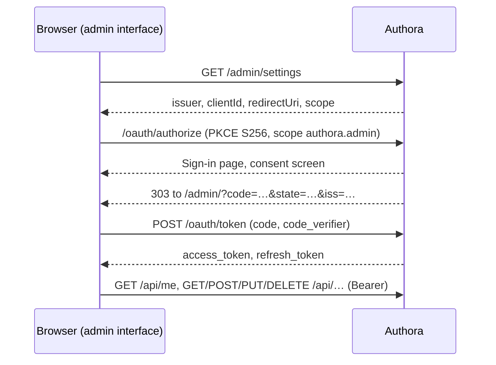

# Authora – Administration

This document describes the admin interface (US-033) and the audit log (US-034). The admin API itself is documented in Swagger (`/swagger` in Development); its authorization is described in [oauth-core.md](oauth-core.md) and `CLAUDE.md`.

- Admin interface: `src/Authora.Api/wwwroot/admin/` (static files), `src/Authora.Api/Controllers/AdminUiController.cs` and `MeController.cs`
- Audit log: `src/Authora.Core/Application/Audit/`, `src/Authora.Infrastructure/Persistence/AuditLog.cs`, `src/Authora.Api/Controllers/AuditEventsController.cs`

## Admin interface (US-033)

The admin interface is served at `{Issuer}/admin/`. It manages Users, Groups, Roles, Clients and Scopes and shows the audit log, so Authora can be operated without database access.

### How it works

The admin interface is a browser app made of static files (HTML, CSS and JavaScript modules, no build step). It has no server-side part of its own: it signs in and calls the admin API exactly like any other browser-based Client.

- **Client:** at startup, Authora creates the Public Client `Authora Admin UI` with the Redirect URI `{Issuer}/admin/` and the allowed Scope `authora.admin`, unless a Client with this Redirect URI already exists. `GET /admin/settings` returns the oldest enabled Public Client with this Redirect URI. Disabling that Client disables the admin interface; deleting it recreates it on the next start. With an Issuer like `http://localhost:5000`, the Client cannot be created (HTTP Redirect URIs need a loopback IP address), and event 7009 is logged.
- **Permissions:** the Access Token only says that the User allowed the admin interface to manage Authora. Every action still needs the User's Permission, checked by the admin API. `GET /api/me` returns the User and their Permissions, and the interface hides what the User may not do; this is only for convenience, not a security boundary.
- **Tokens:** kept in `sessionStorage`, so they are gone when the tab is closed and are not shared with other tabs. The Access Token is refreshed shortly before it expires; concurrent requests share one refresh, because a Refresh Token used twice revokes the whole Grant. On `401` the interface refreshes once and otherwise signs in again.
- **Sign-out** revokes the Refresh Token (and with it the Grant and its Access Tokens), forgets the tokens and opens `/account/logout`, which ends the Session.
- **Consent:** Authora asks for consent on every authorization request, so the consent screen is shown on every sign-in (see TD-012 in [tech-debt.md](tech-debt.md)).

### Security

| Measure | Purpose |
|---|---|
| Content Security Policy `default-src 'none'; script-src 'self'; style-src 'self'; img-src 'self' data:; connect-src 'self'; form-action 'self'; frame-ancestors 'none'; base-uri 'none'` | No inline or foreign scripts or styles can run, so an injected script cannot read the tokens. No framing (clickjacking). |
| All text is inserted as text nodes, never as HTML | Names and descriptions from the API cannot inject markup. |
| `Cross-Origin-Opener-Policy: same-origin` | Other windows cannot reach the admin interface through `window.opener`. |
| `state` and `iss` are checked on the authorization response, PKCE `S256` | CSRF on the sign-in, mix-up attacks, intercepted codes. |
| The code is removed from the address bar right away | The code does not stay in the history. |
| API calls use `credentials: 'omit'` and the admin API only accepts Bearer tokens | No CSRF against the admin API through the Session cookie. |
| `Cache-Control: no-cache` for all files | Browsers load the new version after an update. |

### Configuration

| Setting | Default | Description |
|---|---|---|
| `Authora:AdminUi:Enabled` | `true` | When `false`, `/admin/*` answers `404` and the Client is not created. An existing Client is kept. |

### Pages

| Page | Needs | Supported changes |
|---|---|---|
| Users | `users.read` | Create, edit Email and Name, set password, activate, deactivate, unlock, sign out everywhere, delete, assign and remove Roles. Shows Groups and effective Permissions with their source. |
| Groups | `groups.read` | Create, edit, delete, assign and remove Roles (not the administrator Role), add members by searching Users, remove members. |
| Roles | `roles.read` | Create, edit, delete (not System Roles), grant and revoke Permissions (not on the administrator Role). |
| Clients | `clients.read` | Register (the Secret of a Confidential Client is shown once), edit, enable, disable, delete, add and remove Redirect URIs, allow Scopes, serve Scopes, create and revoke Secrets. |
| Scopes | `scopes.read` | Create, edit, delete (optionally removing it from Clients). |
| Audit log | `audit.read` | Search, see below. |

Each change needs the Permission of its endpoint, e.g. `users.set-password`. Successful changes and errors (the `detail` of the problem details, or the validation messages) are shown as messages in the corner of the page. Destructive actions ask for confirmation.

## Audit log (US-034)

Security-relevant events are stored in the table `audit.events` (schema `audit`). They are only ever added; neither the API nor the admin interface can change or delete them. The cleanup deletes them after `Authora:Cleanup:AuditRetention` (default 365 days, at least 30).

### What is recorded

| Area | Types |
|---|---|
| Sign-in | `account.sign-in` (succeeded, or failed with the reason: unknown Email, wrong password, locked out, cannot sign in), `account.locked-out`, `account.signed-out` |
| Attacks on tokens | `oauth.authorization-code-reused`, `oauth.refresh-token-reused` |
| Users | `user.created`, `user.updated`, `user.deleted`, `user.activated`, `user.deactivated`, `user.unlocked`, `user.sessions-revoked`, `user.password-set`, `user.role-assigned`, `user.role-removed` |
| Groups | `group.created`, `group.updated`, `group.deleted`, `group.member-added`, `group.member-removed`, `group.role-assigned`, `group.role-removed` |
| Roles | `role.created`, `role.updated`, `role.deleted`, `role.permission-granted`, `role.permission-revoked` |
| Scopes | `scope.created`, `scope.updated`, `scope.deleted` |
| Clients | `client.registered`, `client.updated`, `client.deleted`, `client.enabled`, `client.disabled`, `client.redirect-uri-added`, `client.redirect-uri-removed`, `client.scope-allowed`, `client.scope-disallowed`, `client.scope-served`, `client.scope-no-longer-served`, `client.secret-created`, `client.secret-revoked` |
| Authora | `system.administrator-bootstrapped`, `system.client-bootstrapped`, `system.signing-keys-changed` |

Each event has:

| Field | Content |
|---|---|
| `occurredAt` | Time (UTC). |
| `type`, `outcome` | What happened and whether it `Succeeded` or `Failed`. |
| `actorUserId`, `actorClientId` | The User of the Access Token or Session and the Client of the Access Token. For events at the token endpoint, the Client that called it. Empty for events of Authora itself. |
| `ipAddress` | The IP address of the request. Behind a reverse proxy only correct with `Authora:ForwardedHeaders`, see [operations.md](operations.md#reverse-proxy). |
| `targetType`, `targetId` | The object: `user`, `group`, `role`, `scope`, `client` or `signing-key` and its Id (`kid` for keys). |
| `details` | A short description, e.g. the Name of an assigned Role. |

Rules:

- Changes are recorded in the same transaction as the change itself, so an event exists if and only if the change was saved. Requests that change nothing (e.g. assigning a Role that is already assigned) and rejected requests record nothing.
- Failed sign-ins and token reuse are recorded right away, independent of other changes.
- Sign-in events have the User as target, because nobody is signed in yet when they occur. Search by `targetId` to see the sign-ins of a User.
- **Never recorded:** passwords, Session tokens, codes, Access and Refresh Tokens, Client Secrets, private keys. The Email of a failed sign-in for an unknown account is not recorded either, because it may be a password typed into the wrong field. Only Ids and Names are recorded.
- The Email of the acting User and the Name of the acting Client are looked up when reading, so they are current and are not copied into the log.

### Searching

`GET /api/audit-events` needs the Permission `audit.read`, which only the administrator Role has by default. Access is itself restricted to Access Tokens with `authora.admin`, like the whole admin API.

| Parameter | Matches |
|---|---|
| `type` | A Type (`user.created`) or an area (`user` matches `user.*`). |
| `actorUserId` | Events caused by this User. |
| `targetType`, `targetId` | Events about this object. |
| `outcome` | `Succeeded` or `Failed`. |
| `from`, `to` | `from` ≤ time < `to`, ISO 8601 with offset, e.g. `2026-10-01T00:00:00Z`. |
| `page`, `pageSize` | 1-based page, at most 200 events per page. |

The newest events come first. The admin interface links from Users, Groups, Roles, Clients and Scopes to their events.

### Limitations

See [tech-debt.md](tech-debt.md): the events are stored in Authora's own database, so someone with write access to the database can change them (TD-013). For tamper-evident storage, also ship the application logs to a separate log system; they contain the security events (sign-ins, lockouts, token reuse, key changes) and most changes with their Event Ids.
