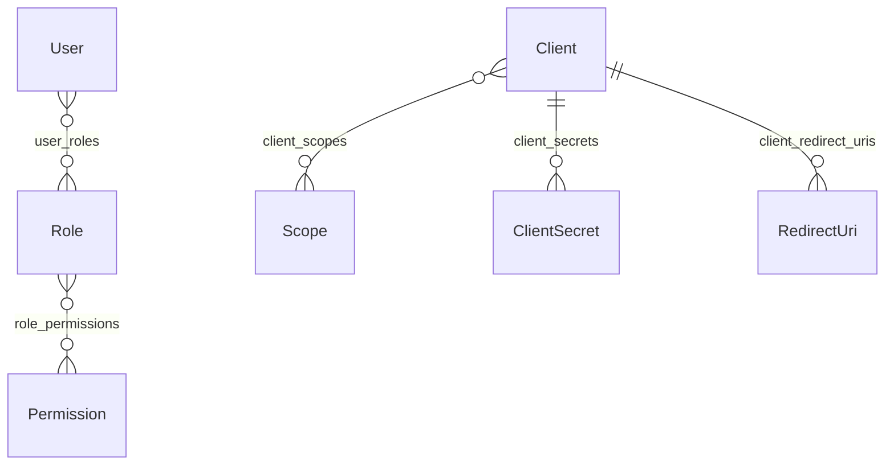

# Authora – Identity Domain

This document describes the identity domain of Authora: the entities, value objects and relationships that represent users, client applications and their access rights.

- Domain code: `src/Authora.Core/Domain/`
- EF Core mapping: `src/Authora.Infrastructure/Persistence/Configurations/`
- Database schema: `identity` (PostgreSQL)

The OAuth 2.1 runtime state (Sessions, Authorization Codes, Refresh Tokens) is not part of this domain yet and will live in the `auth` schema.

## Overview

The model has two sides that only meet at runtime:

| Side | Question it answers | Chain |
|---|---|---|
| User side (RBAC) | What may this **user** do? | User → Role → Permission |
| Client side (OAuth) | What may this **client** do on behalf of a user? | Client → Scope |

See [Permission vs. Scope](#permission-vs-scope) for how both are checked together.

## Aggregates

Each aggregate root is loaded and saved as a whole. Child objects are only changed through methods on the root.

| Aggregate root | Children | References (many-to-many) |
|---|---|---|
| `User` | – | `Roles` |
| `Client` | `ClientSecret`, `RedirectUri` | `AllowedScopes` |
| `Role` | – | `Permissions` |
| `Permission` | – | – |
| `Scope` | – | – |

## Common conventions

- **Ids** are `Guid` version 7 (`Guid.CreateVersion7()`), created in code, not by the database. Version 7 Guids are time-ordered, which keeps PostgreSQL indexes compact.
- **Timestamps** are UTC. `CreatedAt` is set on creation, and `ModifiedAt` is `null` until the first change.
- **Collections** are exposed as `IReadOnlyCollection<T>` and backed by a private list. Use the methods on the entity to change them.
- **Secrets and passwords** never enter the domain in plain text. The application layer hashes them and passes only the hash.

## Entities

### User

The identity that signs in to Authora. The `Id` is also used as the `sub` claim in issued tokens.

| Property | Description |
|---|---|
| `Email` | Email as entered. Used for display and sending emails. |
| `NormalizedEmail` | Trimmed, lowercase Email. Unique. Used for lookups and uniqueness checks. |
| `FirstName`, `LastName` | Name of the User. |
| `PasswordHash` | Hash of the password, or `null` if no password has been set yet. |
| `State` | `Active`, `Inactive`, `Deactivated` or `Deleted`. See [UserState](#userstate). |
| `FailedLoginCount`, `LockoutEndAt` | Brute-force protection (US-007). |
| `LastLoginAt` | Last successful login. Used to detect `Inactive` Users. |
| `SecurityStamp` | Random value that changes on security-relevant events. Sessions and Refresh Tokens issued with an older value are invalid. |
| `Roles` | Assigned Roles. |

Rules:

- A User can only be created via `User.Create(email, firstName, lastName)`. Created Users are `Active` and have no password.
- `SetEmail` validates the Email (not empty, at most 254 characters, a single plain address) and always updates `Email` and `NormalizedEmail` together.
- A User without a `PasswordHash` cannot sign in. The password is set via `SetPasswordHash`, e.g. through the password reset flow (US-010).
- `SetPasswordHash` also rotates the `SecurityStamp`, so all existing Sessions and Refresh Tokens become invalid.
- Call `RotateSecurityStamp` on deactivation and "sign out everywhere" as well.

Methods: `Create`, `SetEmail`, `SetPasswordHash`, `RotateSecurityStamp`, `AssignRole`, `RemoveRole`, `Normalize` (static).

### Client

A client application registered with Authora that requests tokens via OAuth 2.1. The `Id` is also the public OAuth `client_id`. A `client_id` is not a secret (RFC 6749, Section 2.2).

| Property | Description |
|---|---|
| `Name` | Display name, e.g. shown on the consent screen. |
| `Type` | `Public` or `Confidential`. Cannot be changed after registration. |
| `Status` | `Enabled` or `Disabled`. Disabled Clients cannot obtain new tokens. |
| `AllowedGrantTypes` | Flags of allowed grant types. Defaults to `AuthorizationCode \| RefreshToken`. |
| `AccessTokenTTL` | Access Token lifetime in seconds. Defaults to 3600 (1 hour). |
| `RefreshTokenTTL` | Refresh Token lifetime in seconds. Defaults to 86400 (24 hours). |
| `Secrets` | Client Secrets, including expired and revoked ones. |
| `RedirectUris` | Registered Redirect URIs. |
| `AllowedScopes` | Scopes the Client may request. |

Rules:

- Only `Confidential` Clients can have Secrets. `AddSecret` throws for `Public` Clients.
- PKCE is required for all Clients and is not configurable (OAuth 2.1).
- The `redirect_uri` of an authorization request must exactly match a registered Redirect URI (`IsRedirectUriAllowed`).
- A requested scope must be in `AllowedScopes` (`IsScopeAllowed`). Scope names are compared case-sensitively.

Methods: `Enable`, `Disable`, `AddRedirectUri`, `RemoveRedirectUri`, `IsRedirectUriAllowed`, `AddSecret`, `RevokeSecret`, `AllowScope`, `DisallowScope`, `IsScopeAllowed`.

### ClientSecret

A Secret a Confidential Client uses to authenticate at the `/token` endpoint. It belongs to the Client aggregate and is only created and revoked through the Client.

| Property | Description |
|---|---|
| `SecretHash` | Hash of the Secret. The plain-text Secret is shown once on creation and never stored. |
| `ExpiresAt` | Expiry, or `null` if the Secret never expires. |
| `RevokedAt` | Revocation time, or `null` if not revoked. |

A Client can have several active Secrets at once, which allows rotation without downtime: add a new Secret, update the Client application, then revoke the old Secret. Secrets are revoked, not deleted, so the history stays available for auditing.

Methods: `IsActive(now)`, `Revoke(now)`.

### Role

A reusable set of Permissions that can be assigned to Users.

| Property | Description |
|---|---|
| `Name` | Unique technical name, e.g. `admin`. |
| `DisplayName` | Human-readable name for the admin interface. |
| `Description` | Optional description. |
| `IsSystem` | Built-in Role. Must be protected against deletion (US-027). |
| `Permissions` | Granted Permissions. |

Methods: `GrantPermission`, `RevokePermission`.

### Permission

An action a User may perform, e.g. `users.create`. Permissions are granted to Users through Roles. `Name` is unique.

### Scope

An access right a Client can request on behalf of a User, e.g. `openid` or `orders.read`. Scopes are requested via the `scope` parameter and shown on the consent screen.

| Property | Description |
|---|---|
| `Name` | Unique name as used in the `scope` parameter. Must not contain spaces (RFC 6749, Section 3.3). |
| `DisplayName` | Shown on the consent screen. |
| `Description` | Optional description, shown on the consent screen. |

## Value objects

### RedirectUri

A Redirect URI registered for a Client. It has no Id, is immutable and is compared by value (`record`). An instance can only be created via `RedirectUri.Create(value)`, so an invalid Redirect URI cannot exist.

Validation:

- The URI must be absolute.
- The URI must not contain a fragment (`#...`).
- The URI must use HTTPS. HTTP is only allowed for loopback addresses, e.g. for local development.

`Matches(requested)` performs the exact, case-sensitive string comparison OAuth 2.1 requires.

## Enums

### UserState

| Value | Can sign in | Meaning |
|---|---|---|
| `Active` | Yes | Normal state. |
| `Inactive` | Yes | The User did not sign in for a defined period. Signing in makes the User `Active` again. |
| `Deactivated` | No | Deactivated by an administrator. Data is kept. |
| `Deleted` | No | Deleted. The record is only kept for history. |

### ClientType

| Value | Meaning |
|---|---|
| `Public` | Cannot keep a Secret, e.g. single-page, mobile or desktop apps. Does not authenticate at `/token` and relies on PKCE. |
| `Confidential` | Can keep a Secret, e.g. server-side web apps. Must authenticate at `/token` and also uses PKCE. |

### ClientStatus

`Enabled` or `Disabled`.

### GrantTypes

A `[Flags]` enum, so values can be combined with `|` and checked with `HasFlag`. Never compare with `==`, because that fails as soon as more than one flag is set.

| Value | `grant_type` at `/token` |
|---|---|
| `AuthorizationCode` | `authorization_code` |
| `RefreshToken` | `refresh_token` |

## Permission vs. Scope

Permissions and Scopes answer different questions and are checked together at runtime:

1. The Client requests a Scope, e.g. `users.manage`. Authora checks that the Client may request it (`Client.IsScopeAllowed`), and the User approves it on the consent screen.
2. The issued token contains the User (`sub`) and the granted Scopes (`scope`).
3. The API checks both:
   - **Scope:** the token contains `users.manage`, so the User allowed this Client to manage users.
   - **Permission:** the User has `users.create` through one of their Roles, so the User is allowed to do it.

A Scope never grants a User more rights than the User already has. It only limits what the Client can do with them.

A direct link between Scopes and Permissions (`scope_permissions`) is intentionally not modelled yet. It will be decided when the access checks are designed (US-032).

## Persistence

All tables are in the `identity` schema. Enums are stored as integers.

| Table | Contains | Primary key | Notes |
|---|---|---|---|
| `users` | `User` | `Id` | Unique index on `NormalizedEmail`. |
| `clients` | `Client` | `Id` | |
| `client_secrets` | `ClientSecret` | `Id` | FK `ClientId` → `clients`, cascade delete. |
| `client_redirect_uris` | `RedirectUri` | (`ClientId`, `Uri`) | Owned by `Client` (`OwnsMany`), cascade delete. |
| `client_scopes` | Client ↔ Scope | (`ClientId`, `ScopeId`) | Cascade delete on both sides. |
| `roles` | `Role` | `Id` | Unique index on `Name`. |
| `role_permissions` | Role ↔ Permission | (`RoleId`, `PermissionId`) | Cascade delete on both sides. |
| `permissions` | `Permission` | `Id` | Unique index on `Name`. |
| `user_roles` | User ↔ Role | (`UserId`, `RoleId`) | Cascade delete on both sides. |
| `scopes` | `Scope` | `Id` | Unique index on `Name`. |

The composite primary keys of the join tables prevent duplicate assignments.

`AuthoraContext` exposes `DbSet`s for the aggregate roots only: `Users`, `Clients`, `Roles`, `Permissions` and `Scopes`. Client Secrets and Redirect URIs are loaded and saved through their Client.

## Working with the domain

- **Load collections before changing them.** Use `Include` (e.g. `.Include(u => u.Roles)`) before calling methods like `AssignRole`, `AllowScope` or `GrantPermission`. Without it, the collection is empty: duplicate checks do not work and removals do nothing.
- **Do not use `DbSet.Update()` for aggregates with collections.** Because Ids are created in code, `Update()` treats new children (e.g. a new `ClientSecret`) as existing rows and saving fails. Load the aggregate tracked, change it through its methods and call `SaveChangesAsync()`.
- **Check `IsSystem` before deleting a Role.** Deleting a Role cascades to `user_roles` and silently removes it from all Users.
- **Handle domain validation errors.** `User.Create`, `SetEmail`, `SetPasswordHash` and `RedirectUri.Create` throw `ArgumentException` for invalid input. The API should return 400 for these.

## Not covered yet

| Topic | Planned in |
|---|---|
| Sessions, Authorization Codes, Refresh Tokens (`auth` schema) | Phases 2 and 4 |
| Password hashing and the password reset flow | US-007, US-010 |
| Groups and roles assigned through groups | US-029, US-030 |
| Scope ↔ Permission mapping | Decided with US-032 |
| Signing keys | US-024, US-035 |
| Audit events | US-034 |
