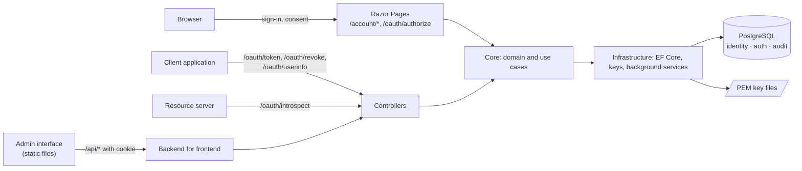

# Architecture

Authora is a single ASP.NET Core application backed by one PostgreSQL database. This page explains how it is put together and why. It is useful background for operators and the starting point for contributors.

## The big picture



One process serves everything: the OAuth and OpenID Connect endpoints, the sign-in and consent pages, the admin API and the admin interface. Background services in the same process clean up expired data, seal audit events and reload signing keys. Several instances can run side by side; they coordinate through the database.

## Three projects

The code is split into three projects with a strict dependency direction:

```
Authora.Api  →  Authora.Core  ←  Authora.Infrastructure
```

**Authora.Core** knows nothing about HTTP or databases. It contains:

- the **domain**: entities such as `User`, `Client`, `Role` and `Grant`. They are created through factory methods and changed through methods (`client.Enable()`, `user.AssignRole(…)`) that enforce their rules, so an invalid object cannot exist.
- the **use cases**: one service class per action (`RegisterClientService`, `IssueTokenService`, …), each with a single `ExecuteAsync` method and its own request and response types.
- **abstractions** for what it needs from the outside: repositories, password and secret hashing, signing keys, transactions.

**Authora.Infrastructure** implements those abstractions with Entity Framework Core and PostgreSQL, loads keys from files, and runs the background services.

**Authora.Api** is the thin outer layer: controllers and Razor Pages that translate HTTP into calls to Core services, plus authentication, rate limiting, security headers and the wiring in `Program.cs`.

This split keeps the security rules in one place. Whether a request comes through the token endpoint, the admin API or the admin interface's backend, the same Core service applies the same checks.

## The database

PostgreSQL holds all state, in three schemas:

| Schema | Content |
|---|---|
| `identity` | Users, Groups, Roles, Permissions, Scopes, Clients with their Redirect URIs and Secret hashes. |
| `auth` | Sessions, Authorization Codes, Grants, Access and Refresh Tokens, as hashes only. |
| `audit` | Audit events and their hash chain. |

The schemas separate data by how it is used and protected. `auth` changes constantly and can be wiped (e.g. after restoring a backup) without losing configuration. `audit` is append-only for the application user.

Rules that must hold across concurrent requests, such as "never remove the last administrator", run in a transaction with a PostgreSQL advisory lock, so two instances cannot both pass the check.

Authora never changes its schema at startup. Migrations are a separate, explicit step, so a deployment never alters the database by accident and the application user needs no rights to change the schema.

## What is not in the database

- **Signing keys** live in files. A stolen database copy then cannot be used to forge ID Tokens.
- **Plain-text secrets** are never stored. Passwords are hashed with PBKDF2; Client Secrets, codes and tokens with SHA-256. A database copy cannot be used to call APIs.
- **Data Protection keys**, which encrypt cookies, live in a separate directory.

## Two ways to authenticate a request

Authora has two authentication schemes and keeps them apart on purpose:

| Scheme | Accepted by | Carries |
|---|---|---|
| Session cookie | The sign-in and consent pages only | The User's sign-in at Authora |
| Access Token | The admin API, UserInfo | A User's approval for a Client, with Scopes |

A Session cookie alone never grants access to the admin API. Even the admin interface, which runs in the same origin, gets an Access Token like any other Client. See [The admin interface](admin-interface.md).

## Background services

| Service | Job |
|---|---|
| Cleanup | Deletes expired and revoked codes, tokens, Grants and Sessions after a retention period, and old audit events. |
| Audit chain sealer | Seals new audit events into the hash chain every few seconds. |
| Signing key reload | Re-reads the key files, so keys can be rotated without a restart. |

They run in every instance and use advisory locks where only one instance may act at a time.

## Startup

At startup, Authora:

1. validates every setting and refuses to start with an insecure or invalid configuration;
2. loads the signing keys;
3. seeds what it needs to work: the Permissions, the `admin` Role, the System Scopes, the admin interface's Client and, if configured, the first administrator.

Seeding is idempotent and never overwrites changes an administrator made.
