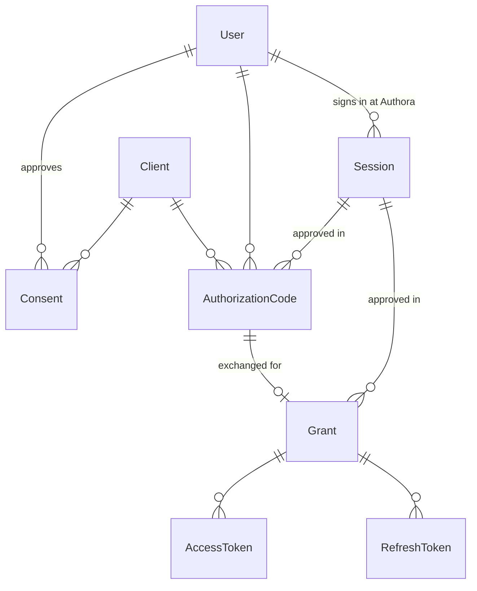
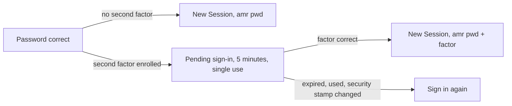

# Tokens, Grants and Sessions

This page explains the objects Authora creates when someone signs in, how they relate, and why Authora's Access Tokens are opaque.

## The objects

| Object | What it is |
|---|---|
| **Session** | The User's sign-in at Authora itself, held in a browser cookie. It lets the User approve several applications without typing the password again (single sign-on). |
| **Consent** | The User's remembered approval of a third-party Client: the Scopes the User allowed it. Without it, or for a Scope it lacks, the consent screen is shown. It does not expire; the User revokes it under *Connected applications* (`/account/consents`), an administrator through the admin API. Revoking it revokes the Grants of the User for the Client, and the code exchange rejects codes of a revoked Consent, because every code is bound to the Consent it was issued under; approving the Client again creates a new Consent. |
| **Authorization Code** | A one-minute, single-use ticket that the browser carries from Authora back to the application. It is bound to the Client, the User, the Session, the Redirect URI, the Scopes and, if sent, the PKCE challenge. |
| **Grant** | Created when the code is exchanged: the tokens of one sign-in of the User to this Client, with these Scopes. It is the unit of revocation. A Client that obtains a token for itself (`client_credentials`) gets a Grant without a User, which holds just that Access Token. |
| **Access Token** | What the application presents to APIs. Short-lived (1 hour by default). |
| **Refresh Token** | What the application uses to get new Access Tokens without the user. Longer-lived (1 day by default) and single-use. |

A Grant remembers the Session it was approved in. Ending that Session on purpose (signing out, or one of the other ways in [Ending a Session](#ending-a-session)) revokes the Grant too, and tells the application if it asked to be told. A Session that simply expires leaves its Grants alone, and revoking a Grant never signs the User out of Authora.

## Why Access Tokens are opaque

Many identity providers issue Access Tokens as signed JWTs, which APIs can check without asking the provider. Authora instead issues **opaque reference tokens**: 256 random bits with no content. An API learns what a token means only by asking Authora through the introspection endpoint.

The trade-off is deliberate:

| | Opaque (Authora) | Self-contained JWT |
|---|---|---|
| Revocation | Immediate: the next introspection says `active: false`. | Only when the token expires, unless every API checks a revocation list. |
| User deactivated, password changed, Client disabled | Immediate. | Only when the token expires. |
| Content visible to the application or in logs | None. | Every claim, to anyone holding the token. |
| Signing keys needed for Access Tokens | No. | Yes; a leaked key forges tokens for every API. |
| Cost | One request to Authora per check (cacheable for a short time). | Local check. |

For a small, self-hosted deployment, immediate revocation and a smaller attack surface are worth an extra request. ID Tokens, which are meant to be read by the application once at sign-in, are signed JWTs as OpenID Connect requires.

## Only hashes are stored

Codes, Access Tokens, Refresh Tokens, Session tokens, the one-time tokens of email links and Client Secrets are stored only as SHA-256 hashes. Someone with a copy of the database cannot use any of them.

## When is a token valid?

Every check, whether introspection, UserInfo or the admin API, walks the whole chain:

1. The token exists, has not expired and was not revoked.
2. Its **Grant** was not revoked and has not reached its lifetime (90 days by default).
3. Its **Client** still exists and is enabled.
4. Its **User**, if it has one, can still sign in and has the same *security stamp* as when the Grant was created.

The security stamp is a random value on the User that changes when the User is deactivated or deleted, gets a new password, or is signed out everywhere. Changing it invalidates every Session and token of the User at once, without touching each one.

There is one exception. When Users change their own password at `/account/password`, the Session they did it in takes over the new stamp in the same transaction, so they stay signed in in that browser. Every other Session ends, and so does every Grant with its Access and Refresh Tokens, including the Grants that applications got through this very Session: whoever knew the old password, or held a token, is locked out, and applications ask the User to sign in again. Because that browser's Session is still valid, this usually happens without typing the password. An administrator who sets a password through the admin API keeps no Session alive, and neither does a password reset by email: the User proves control of the mailbox, not of a Session, so they sign in again everywhere.

## Single use and reuse detection

**Authorization Codes** are marked as used in one atomic database statement before anything else is checked. Even two simultaneous requests cannot both use a code, and a failed attempt (e.g. a wrong PKCE verifier) still uses it up.

**Refresh Tokens** rotate: each use returns a new Refresh Token and uses up the old one.

If a used code or a used Refresh Token is presented again, Authora cannot tell whether the legitimate application or an attacker sent it. It therefore revokes the **whole Grant**, so neither party keeps access, logs a warning and records an audit event. The legitimate application notices on its next request and sends the user to sign in again. You can watch this happen in [Your first application](../tutorials/first-application.md#9-watch-authora-catch-a-replayed-token).

Reuse can only be detected while the used row still exists; the cleanup keeps rows for 7 days after they expire (`Authora:Cleanup:Retention`).

## Lifetimes and their limits

| What | Default | Bounded by |
|---|---|---|
| Authorization Code | 1 minute | at most 10 minutes |
| Access Token | 1 hour, per Client | at most 1 day, and the Grant |
| Refresh Token | 1 day, per Client | at most 90 days, and the Grant |
| Grant | 90 days | at most 365 days |
| Session | 2 hours idle, 12 hours absolute | at most 24 hours idle, 7 days absolute |
| Pending sign-in (between password and second factor) | 5 minutes | at most 15 minutes |
| ID Token | 5 minutes | at most 1 hour |

The Grant's lifetime is absolute. Refreshing does not extend it, so a stolen Refresh Token cannot keep access alive forever. After it ends, the application has to send the user through Authora again; the consent screen only appears if the Consent was revoked or the application asks for more Scopes.

## Sessions

The Session cookie holds a random token; the database holds its hash. Authora checks the idle timeout, the absolute lifetime and the User's security stamp on every request, so ending a Session on the server takes effect immediately, even though the cookie itself has no expiry. Every sign-in creates a new Session and ends the previous one in that browser, which prevents session fixation.

An Authorization Code remembers the Session in which the User approved the request, and can only be exchanged while that Session is still active (not signed out, not expired, not idle for too long). Otherwise a code issued just before the User signed out, e.g. on a shared computer, could still be redeemed until it expires and start a new Grant for a User who has left. Such a code gets `invalid_grant` and is logged as event 6015. The exchange holds a lock on the Session while it creates the Grant, so a sign-out at the same moment either comes first and the code is rejected, or waits and then revokes the new Grant as well.

### Ending a Session

A Session ends in two ways, and they are treated differently on purpose.

**It runs out.** The absolute lifetime passes, or the User is idle for too long. Nothing happens at that moment: the next request with the cookie is simply refused. The Grants approved in the Session keep working until they expire, as they always have in OAuth, because the User did not ask to leave and applications may legitimately keep refreshing tokens. No one is notified; applications see their own tokens expire.

**It is ended on purpose.** The User signs out at `/account/logout` or through an application (`/oauth/logout`), changes or resets the password, removes a second factor, or an administrator signs the User out, deactivates or deletes them, sets their password or resets their second factors. Then Authora, in one database transaction:

1. marks the Sessions as revoked (for a password change or a removed second factor, all except the one the User is using),
2. revokes every Grant approved in those Sessions, so their Access and Refresh Tokens stop working at once, and
3. writes a notification for every application that received tokens in those Sessions and registered a Back-Channel Logout URI.

A background service on each instance then sends each notification as a signed Logout Token ([OpenID Connect Back-Channel Logout 1.0](https://openid.net/specs/openid-connect-backchannel-1_0.html)) and retries with a growing delay if the application does not answer. Because the notifications are rows in the database rather than a queue in memory, they survive a restart and any instance can send them; a claim on each row keeps two instances from sending the same one at once.

The Logout Token names the User (`sub`) and the Session (`sid`). Every ID Token carries the same `sid`, a random value that is not the Session's database Id (whose time-ordered Guid would reveal when the User signed in). An application that stored the `sid` from the ID Token can end exactly the local session that belongs to it; see [Receive back-channel logout](../how-to/receive-back-channel-logout.md).

Revoking the Grants also covers applications without a Back-Channel Logout URI: they are not told, but their Refresh Token stops working, and introspection reports their Access Token as inactive.

### How a User signs in

Signing in can take two steps. The password is always the first. A User who has enrolled a second factor gets **no Session** for the password alone, only a *pending sign-in*:

- The pending sign-in is a database row in the `auth` schema; the browser holds its random token in a cookie of its own (`__Host-authora_pending_sign_in`, `SameSite=Strict`), never in the Session cookie. Until the second factor is done, the browser is not signed in, and an existing Session of the browser stays as it was.
- It lasts 5 minutes (`Authora:SignIn:PendingSignInLifetime`), can be completed only once (an atomic update decides between concurrent requests), and only while the User has the security stamp it started with: a password reset, a deactivation or "sign out everywhere" in between ends it. The cleanup deletes it once it has expired.
- A wrong second factor counts towards the same lockout as a wrong password. A correct password does not reset the failed attempts while a second factor is pending, so knowing the password does not allow guessing the second factor endlessly; only a complete sign-in resets them.
- A password reset by email sets the password and nothing else: it never signs in and never skips the second factor.

The second factor is an authenticator app (TOTP), with single-use recovery codes for a lost phone, or a passkey; Users without one sign in with the password alone. See [Authenticator app and recovery codes](#authenticator-app-and-recovery-codes) and [Passkeys](#passkeys).

### What a Session knows about the sign-in

Each Session records **how** the User authenticated, as Authentication Method Reference values of RFC 8176 (`pwd` for the password, `fed` for an external identity provider, e.g. `otp` for a one-time code), and **when** the User last authenticated in it. Both are copied into every Authorization Code issued in the Session and from there into the Grant, so the ID Token's `auth_time` is the latest authentication, its `amr` lists the methods and its `acr` names the level they reach (`urn:authora:acr:pwd`, `urn:authora:acr:mfa`, or `phr` with a passkey). The admin API reads the methods from the Grant of an Access Token when multi-factor authentication is required for administrators.

A *step-up* adds a factor to an existing Session, e.g. when an application asks for a stronger sign-in: the User completes the factor at `/account/step-up`, and the Session records the additional method and the new authentication time. Like every sign-in, it then gets a **new Session token**, so a token that was copied before the step-up does not gain its strength. The absolute lifetime of the Session does not change.

Sensitive account changes, such as enrolling or removing a factor, require a *recent* authentication: one within `Authora:SignIn:RecentAuthenticationWindow` (10 minutes by default). Otherwise the User is asked to sign in again, which starts a new Session with a new authentication time.

### Authenticator app and recovery codes

Users set up an authenticator app themselves at `/account/security/authenticator`. Unlike passwords and tokens, its secret cannot be stored as a hash: the server needs it to compute the expected code. It is therefore encrypted with ASP.NET Core Data Protection under a purpose of its own, which makes the Data Protection key ring as important to back up as the database: a database restored without its keys has secrets nobody can read, and every User with an app has to fall back to a recovery code or be reset.

- **Setup is confirmed by a code.** Until the User enters a first valid code, the secret is stored but changes nothing about the sign-in, so a QR code that was never scanned cannot lock anyone out. An unfinished setup expires after 15 minutes.
- **A code works once.** Each accepted code records its time step in a single atomic update; the same code, or one of an earlier step, is rejected afterwards. A code that was read over someone's shoulder or phished is worth nothing once the User has used it.
- **Recovery codes are the fallback.** Ten random 80-bit codes are shown once, stored only as SHA-256 hashes, and each works once. They stand in for the app, so a sign-in with one also records `otp`, and its use is audited separately (`mfa.recovery-code-used`). New codes can only be generated in a Session that completed the app, so a Session signed in with the password alone, e.g. from before the setup, cannot obtain codes and use one to remove the app.
- **Removing the app is a sensitive change.** It needs a recent authentication *and* a current code or recovery code, and it ends every other Session and Grant of the User, like a password change. A taken-over Session alone therefore cannot turn the second factor off, and wrong codes count towards the lockout.
- **Administrators can reset it** (`users.reset-mfa`), which ends all Sessions and Grants of the User. Like every action on a User, it follows the rule that nobody acts on a User with more rights than their own, so only an administrator can reset an administrator.

### Passkeys

A passkey is a key pair the User's device or password manager keeps; Authora stores only the public key, so unlike the secret of an authenticator app there is nothing on the server worth stealing, and the Data Protection keys play no part. The browser uses a passkey only on the site it was created for (the WebAuthn relying party, the Issuer's host), which is what makes it *phishing-resistant*: a proxy that relays a code cannot relay a passkey, because the browser would sign for the proxy's origin, and Authora rejects that.

- **Second factor, not passwordless.** Authora asks for the password first and the passkey second, like the app. Passwordless sign-in would change what a stolen device is worth and needs its own recovery story; it is not part of this.
- **`hwk` or `swk`.** A passkey that never leaves its device (e.g. on a security key) records `hwk`, one that may be synced to other devices records `swk`, decided by the backup-eligible flag the authenticator reports. Both reach the level `phr`. Applications that must exclude synced passkeys can check `amr`.
- **Challenges are single-use.** Every ceremony gets a fresh random challenge, bound to the User and to registration or sign-in, valid for 5 minutes and consumed before the response is checked. A captured response cannot be replayed, and a challenge of a registration cannot complete a sign-in.
- **The signature counter detects clones.** Authenticators that count their signatures must report a higher number every time; a response with a counter that did not increase is rejected, because it may come from a copy of the key. Synced passkeys usually report 0, which says nothing and is accepted.
- **No attestation.** Authora does not ask which authenticator model the User has, nor restrict it: any passkey of the browser is fine. The AAGUID is stored only to show it.
- **Changes need the second factor.** Adding or removing a passkey needs a recent authentication and, for a User who already has a second factor, a Session that completed one. Removing a passkey ends every other Session and Grant, so whoever signed in with it elsewhere is signed out. There are no recovery codes for passkeys; Users register more than one, and administrators can remove a single lost passkey or reset everything.
