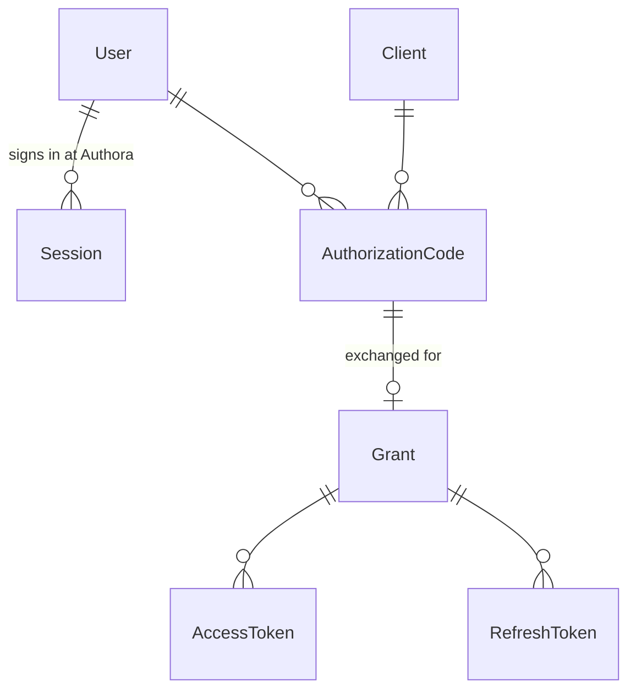

# Tokens, Grants and Sessions

This page explains the objects Authora creates when someone signs in, how they relate, and why Authora's Access Tokens are opaque.

## The objects

| Object | What it is |
|---|---|
| **Session** | The User's sign-in at Authora itself, held in a browser cookie. It lets the User approve several applications without typing the password again (single sign-on). |
| **Authorization Code** | A one-minute, single-use ticket that the browser carries from Authora back to the application. It is bound to the Client, the User, the Redirect URI, the Scopes and the PKCE challenge. |
| **Grant** | Created when the code is exchanged: the User's approval for this Client and these Scopes. It is the unit of revocation. |
| **Access Token** | What the application presents to APIs. Short-lived (1 hour by default). |
| **Refresh Token** | What the application uses to get new Access Tokens without the user. Longer-lived (1 day by default) and single-use. |

A Session and a Grant are independent. Signing out of Authora ends the Session but not the application's Grant; revoking a Grant does not sign the User out of Authora.

## Why Access Tokens are opaque

Many identity providers issue Access Tokens as signed JWTs, which APIs can check without asking the provider. Authora instead issues **opaque reference tokens**: 256 random bits with no content. An API learns what a token means only by asking Authora through the introspection endpoint.

The trade-off is deliberate:

| | Opaque (Authora) | Self-contained JWT |
|---|---|---|
| Revocation | Immediate: the next introspection says `active: false`. | Only when the token expires, unless every API checks a revocation list. |
| User deactivated, password changed, Client disabled | Immediate. | Only when the token expires. |
| Content visible to the application or in logs | None. | Every claim, to anyone holding the token. |
| Signing keys needed for Access Tokens | No. | Yes; a leaked key forges tokens for every API. |
| Cost | One request to Authora per check (cacheable for a short time). | Local check. |

For a small, self-hosted deployment, immediate revocation and a smaller attack surface are worth an extra request. ID Tokens, which are meant to be read by the application once at sign-in, are signed JWTs as OpenID Connect requires.

## Only hashes are stored

Codes, Access Tokens, Refresh Tokens, Session tokens and Client Secrets are stored only as SHA-256 hashes. Someone with a copy of the database cannot use any of them.

## When is a token valid?

Every check, whether introspection, UserInfo or the admin API, walks the whole chain:

1. The token exists, has not expired and was not revoked.
2. Its **Grant** was not revoked and has not reached its lifetime (90 days by default).
3. Its **Client** still exists and is enabled.
4. Its **User** can still sign in and has the same *security stamp* as when the Grant was created.

The security stamp is a random value on the User that changes when the User is deactivated or deleted, gets a new password, or is signed out everywhere. Changing it invalidates every Session and token of the User at once, without touching each one.

## Single use and reuse detection

**Authorization Codes** are marked as used in one atomic database statement before anything else is checked. Even two simultaneous requests cannot both use a code, and a failed attempt (e.g. a wrong PKCE verifier) still uses it up.

**Refresh Tokens** rotate: each use returns a new Refresh Token and uses up the old one.

If a used code or a used Refresh Token is presented again, Authora cannot tell whether the legitimate application or an attacker sent it. It therefore revokes the **whole Grant**, so neither party keeps access, logs a warning and records an audit event. The legitimate application notices on its next request and sends the user to sign in again. You can watch this happen in [Your first application](../tutorials/first-application.md#9-watch-authora-catch-a-replayed-token).

Reuse can only be detected while the used row still exists; the cleanup keeps rows for 7 days after they expire (`Authora:Cleanup:Retention`).

## Lifetimes and their limits

| What | Default | Bounded by |
|---|---|---|
| Authorization Code | 1 minute | at most 10 minutes |
| Access Token | 1 hour, per Client | at most 1 day, and the Grant |
| Refresh Token | 1 day, per Client | at most 90 days, and the Grant |
| Grant | 90 days | at most 365 days |
| Session | 2 hours idle, 12 hours absolute | at most 24 hours idle, 7 days absolute |
| ID Token | 5 minutes | at most 1 hour |

The Grant's lifetime is absolute. Refreshing does not extend it, so a stolen Refresh Token cannot keep access alive forever. After it ends, the user approves the application again.

## Sessions

The Session cookie holds a random token; the database holds its hash. Authora checks the idle timeout, the absolute lifetime and the User's security stamp on every request, so ending a Session on the server takes effect immediately, even though the cookie itself has no expiry. Every sign-in creates a new Session and ends the previous one in that browser, which prevents session fixation.
