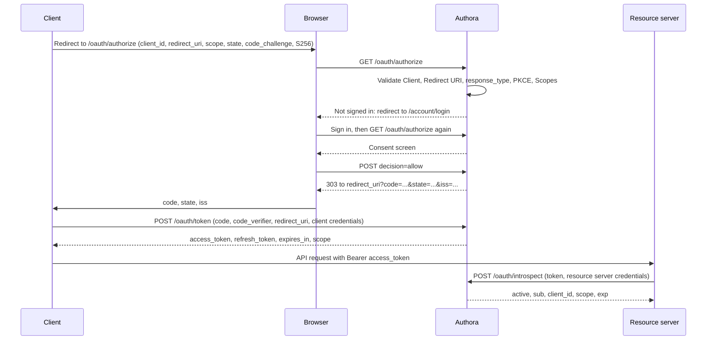
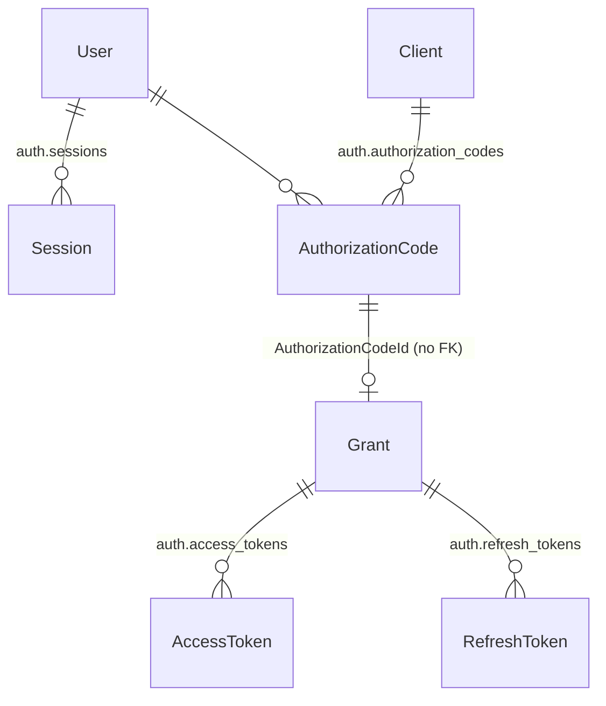

# Authora – OAuth 2.1 Core

This document describes the OAuth 2.1 authorization server of Authora (Phase 4, US-015 – US-021): the endpoints, the flow, the token model and the security rules.

- Application logic: `src/Authora.Core/Application/OAuth/` and `src/Authora.Core/Application/Account/`
- Endpoints: `src/Authora.Api/Controllers/OAuthController.cs` and `src/Authora.Api/Pages/`
- Database schema: `auth` (PostgreSQL)

## Endpoints

| Endpoint | Used by | Purpose |
|---|---|---|
| `GET /oauth/authorize` | Browser | Authorization endpoint. Validates the request, sends the User to sign in, asks for consent and redirects back with a code. |
| `POST /oauth/authorize` | Browser | Submits the consent form. Not called by Clients directly. |
| `POST /oauth/token` | Client | Token endpoint. Grant types `authorization_code` and `refresh_token`. |
| `POST /oauth/revoke` | Client | Revocation endpoint (RFC 7009). |
| `POST /oauth/introspect` | Resource server | Introspection endpoint (RFC 7662). |
| `GET/POST /account/login` | Browser | Sign-in page. |
| `GET/POST /account/logout` | Browser | Sign-out page. |
| `PUT /api/users/{id}/password` | Administrator | Replaces the password of a User. `POST /api/users` already requires an initial password. |

`/oauth/token`, `/oauth/revoke` and `/oauth/introspect` take `application/x-www-form-urlencoded` bodies and answer errors as `{"error": "...", "error_description": "..."}`. A failed Client authentication returns `401` with `WWW-Authenticate: Basic`, all other errors `400`. Responses are sent with `Cache-Control: no-store`.

`/oauth/token` and `/oauth/revoke` allow CORS, so browser-based Clients (SPAs) can call them directly. Allowed are the origins (scheme, host and port) of the Redirect URIs of enabled Clients, only `POST`, only the `Content-Type` header and no credentials. All other endpoints, including `/oauth/introspect`, `/oauth/authorize`, `/account/*` and `/api/*`, send no CORS headers.

Discovery (`/.well-known/...`), ID Tokens, JWKS and UserInfo follow with OpenID Connect in Phase 5.

## Configuration

| Setting | Default | Description |
|---|---|---|
| `Authora:OAuth:Issuer` | – (required) | Issuer Identifier, e.g. `https://auth.example.com`. HTTPS (HTTP only for loopback hosts), no query or fragment. Returned as `iss`. Startup fails if it is missing or invalid. |
| `Authora:OAuth:AuthorizationCodeLifetime` | `00:01:00` | Lifetime of Authorization Codes, at most 10 minutes. |
| `Authora:OAuth:CorsOriginsCacheDuration` | `00:01:00` | How long the CORS origins of `/oauth/token` and `/oauth/revoke` are cached, at most 1 hour. `00:00:00` disables the cache. |
| `Authora:SignIn:SessionIdleTimeout` | `02:00:00` | A Session ends after this time without use. At most 24 hours. |
| `Authora:SignIn:SessionLifetime` | `12:00:00` | A Session ends after this time regardless of use. At most 7 days. |
| `Authora:SignIn:MaxFailedAttempts` | `5` | Failed sign-ins in a row that lock a User out. 1 to 100. |
| `Authora:SignIn:LockoutDuration` | `00:15:00` | How long a User is locked out. At most 1 hour, because anyone who knows an Email can trigger a lockout. |
| `Authora:Cleanup:Interval` | `01:00:00` | How often expired Authorization Codes, Grants, tokens and Sessions are deleted. 1 minute to 1 day. The first run is one interval after startup. |
| `Authora:Cleanup:Retention` | `7.00:00:00` | How long rows are kept after they expired or were revoked, at least 1 day. Reuse of a consumed code or Refresh Token is only detected (and revokes the Grant) while the row exists. |
| `Authora:Cleanup:BatchSize` | `1000` | Rows deleted per statement, 1 to 10000. |

Environment variables use `__` as separator, e.g. `Authora__OAuth__Issuer`.

Durations use the format `hh:mm:ss`. A plain number is read as days, e.g. `15` is 15 days, not 15 minutes; the upper limits make startup fail on such a mistake.

## Authorization Code flow



### Authorization request

| Parameter | Rule |
|---|---|
| `client_id` | Required. Unknown or disabled Clients are rejected on an error page. |
| `redirect_uri` | Must exactly match a registered Redirect URI. May only be omitted if exactly one is registered. A wrong value is rejected on an error page and never redirected to. |
| `response_type` | Must be `code`. |
| `code_challenge`, `code_challenge_method` | Required. Only `S256` is accepted, `plain` is rejected. |
| `scope` | Required. Every Scope must be allowed for the Client (`Client.AllowedScopes`). |
| `state` | Optional. Returned unchanged. |
| `response_mode` | Optional. Only `query`. |

Unknown parameters are ignored, parameters without a value count as omitted, and a parameter sent more than once is rejected (RFC 6749, Section 3.1). Until `client_id` and `redirect_uri` are valid, errors are shown to the User. After that, they are sent to the Redirect URI with `error`, `error_description`, `state` and `iss`.

The request is validated before the User has to sign in, and again when the consent form is submitted, because the form fields come from the browser.

### Consent policy

The User is asked on every authorization request. The consent screen shows the Client Name, the Display Name and Description of every requested Scope, the signed-in User and where the browser will be sent. Decisions are not remembered. Denying sends `error=access_denied` to the Client.

### Authorization response

The code is sent with a `303 See Other` redirect, together with `state` and `iss` (RFC 9207, so the Client can detect mix-up attacks).

### Token request

Client authentication:

| Client Type | Authentication |
|---|---|
| Confidential | `client_secret_basic` (Authorization header) or `client_secret_post` (`client_id` and `client_secret` in the body). One active Secret must match. |
| Public | `client_id` in the body, no Secret. |

Using both methods at once is rejected. A disabled Client cannot obtain tokens.

`grant_type=authorization_code` needs `code`, `code_verifier`, and `redirect_uri` if it was sent in the authorization request. `grant_type=refresh_token` needs `refresh_token` and may send a narrower `scope`.

Response:

```json
{
  "access_token": "…",
  "token_type": "Bearer",
  "expires_in": 3600,
  "refresh_token": "…",
  "scope": "orders.read profile.read"
}
```

A `refresh_token` is only issued if the Client is allowed the `refresh_token` Grant Type.

## Token model

All codes and tokens are random 256-bit values without readable content (`ISecretGenerator`). Only their SHA-256 hash is stored (`ISecretHasher`), so a copy of the database cannot be used to call APIs.

Access Tokens are **opaque reference tokens**. Resource servers validate them through the introspection endpoint. This means:

- revoking a token, a Grant or a Session takes effect immediately,
- disabling a Client or rotating the `SecurityStamp` of a User invalidates its tokens immediately,
- no signing keys are needed yet. Signed JWTs can be added with the signing keys of Phase 5 (US-024).



| Entity | Table | Description |
|---|---|---|
| `Session` | `auth.sessions` | Browser Session of a signed-in User at Authora. The cookie holds the token, the table its hash. |
| `AuthorizationCode` | `auth.authorization_codes` | Code issued by `/oauth/authorize`. Bound to the Client, User, `SecurityStamp`, Redirect URI, Scopes and PKCE code challenge. |
| `Grant` | `auth.grants` | The approval of a User for a Client, created when a code is exchanged. All tokens issued from the code and its Refresh Tokens belong to it, so they can be revoked together. |
| `AccessToken` | `auth.access_tokens` | Access Token. Its Scopes can be narrower than the Grant's. |
| `RefreshToken` | `auth.refresh_tokens` | Refresh Token. Always has the Scopes of its Grant. |

A token is active only if all of these hold:

1. It exists, is not expired and not revoked.
2. Its Grant is not revoked.
3. Its Client exists and is enabled.
4. Its User can sign in (`Active` or `Inactive`, has a password) and still has the `SecurityStamp` the Grant was created with.

### Single use and rotation

- **Authorization Codes** are consumed with a single atomic `UPDATE … WHERE "ConsumedAt" IS NULL` before any other check, so a code can only be used once, even by concurrent requests, and even if the first attempt fails (e.g. a wrong `code_verifier`). A code that is used again revokes the Grant created from it (OAuth 2.1, Section 4.1.3).
- **Refresh Tokens** are rotated: every use consumes the token atomically and returns a new one. A consumed Refresh Token that is used again revokes the whole Grant, including the Access Tokens (OAuth 2.1, Section 4.3.1).
- **Scopes** of a refresh can be narrowed, never widened. Scopes that an administrator disallowed for the Client in the meantime are dropped.

### Revocation (RFC 7009)

- Revoking a Refresh Token revokes its Grant and therefore all Access and Refresh Tokens of it.
- Revoking an Access Token revokes only this token.
- A Client can only revoke its own tokens. Unknown tokens and tokens of other Clients are answered with `200` and left unchanged, so the endpoint does not reveal whether a token exists. Attempts on tokens of other Clients are logged.
- Disabled Clients can still revoke their tokens.

### Introspection (RFC 7662)

- Only enabled Confidential Clients can introspect. Register each resource server as a Confidential Client and use its Secret.
- Access Tokens can be introspected by every such Client. Refresh Tokens only by the Client they were issued to.
- Inactive tokens only return `{"active": false}`, without the reason.
- Active tokens return `active`, `scope`, `client_id`, `sub` (the User Id), `token_type`, `exp`, `iat` and `iss`.

### Events that invalidate tokens

| Event | Effect |
|---|---|
| User revokes the token at `/oauth/revoke` | Access Token, or the whole Grant for a Refresh Token |
| Authorization Code or Refresh Token reused | Whole Grant |
| Client disabled (`POST /api/clients/{id}/disable`) | All Grants of the Client. Enabling the Client again does not restore them. |
| Client deleted | All codes and Grants of the Client (cascade delete) |
| User deactivated or deleted, password set, "sign out everywhere" | All Sessions and tokens of the User (new `SecurityStamp`) |

## Sign-in and Sessions

The authorization endpoint needs a signed-in User, so Phase 4 includes a minimal password sign-in (US-007 – US-009):

- Passwords are hashed with PBKDF2-HMAC-SHA512 and 210,000 iterations (ASP.NET Core Identity password hasher, V3 format). Older hashes are upgraded on the next sign-in.
- Every failure shows the same message. Unknown Emails still verify a password, so the response time does not reveal whether an Email exists.
- After `MaxFailedAttempts` failures in a row, the User is locked out for `LockoutDuration`. `POST /api/users/{id}/unlock` ends it early.
- Sign-in attempts are limited to 10 per minute per IP address (`429 Too Many Requests`). Behind a reverse proxy, the forwarded headers must be configured.
- Every sign-in creates a new Session and ends the previous Session of the browser.
- The cookie `__Host-authora_session` is `Secure`, `HttpOnly`, `SameSite=Lax` and has no expiry. The server enforces the idle timeout and the absolute lifetime and checks the `SecurityStamp` on every request.
- Signing out revokes the Session on the server and deletes the cookie.
- The pages send a Content Security Policy with `frame-ancestors 'none'` and `X-Frame-Options: DENY` against clickjacking, `Referrer-Policy: no-referrer` and `Cache-Control: no-store`. All forms use antiforgery tokens.

A User needs a password to sign in. Until an invite or reset flow exists ([TD-001](../tech-debt.md#td-001-users-can-be-created-without-a-password)), an administrator sets it with `PUT /api/users/{id}/password`. Passwords must be 12 to 128 characters long.

## Logging

Codes, tokens, Secrets, passwords and Emails are never logged, only Ids. Event Ids:

| Range | Area |
|---|---|
| 5001 – 5006 | Sign-in, sign-out, lockout, invalidated Sessions |
| 6001 – 6011 | Codes, Grants, refreshes, reuse detection, revocations, failed Client authentication, rejected authorization requests |

Reuse of a code or Refresh Token (6004, 6005) and tokens presented by another Client (6006) indicate an attack and are logged as warnings.

## Known limitations

See [tech-debt.md](../tech-debt.md): no CORS for browser-based Clients yet ([TD-007](../tech-debt.md#td-007-browser-based-clients-cannot-call-the-token-endpoint-no-cors)), expired codes, tokens and Sessions are not purged ([TD-008](../tech-debt.md#td-008-expired-codes-tokens-and-sessions-are-never-deleted)), and every Confidential Client can introspect every Access Token ([TD-009](../tech-debt.md#td-009-every-confidential-client-can-introspect-every-access-token)).
